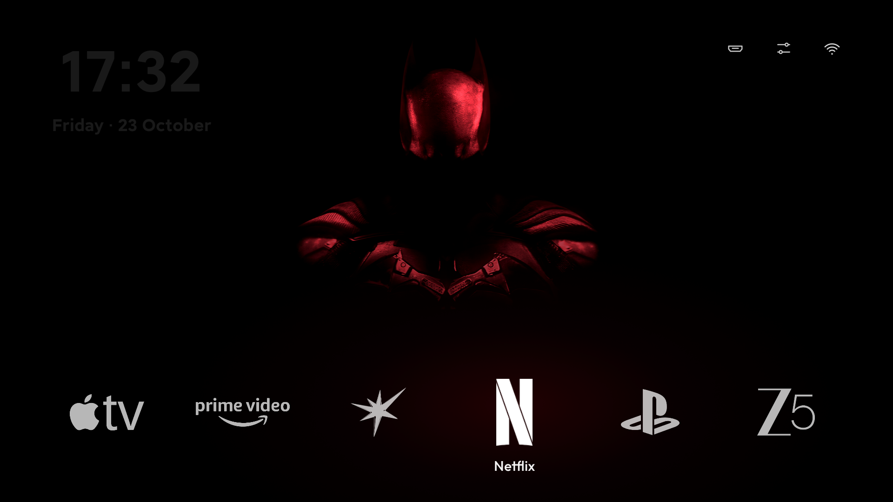

# Mi TV Declutter

A personal Xiaomi Mi TV cleanup report and custom Android TV home screen, maintained by **Sakshya Deep**.

The project records how I reduced preinstalled clutter on my Mi TV while keeping HDMI inputs, casting, streaming apps and the remote working. It includes the launcher source, reversible cleanup tools and a dated record of changes and recovery steps.



## Read the report

- [Cleanup report](docs/cleanup-report.md): TV details, package decisions, changes from October 20–23, 2026, launcher iterations and undo instructions.
- [Package review guide](docs/debloat.md): how to review candidate packages before disabling them.
- [`my-tv.txt`](my-tv.txt): the disabled packages and settings used on my TV.

Tested device: Xiaomi Mi TV (`MiTV-AXSO2`, `dangalUHD`), Android TV 11, approximately 2 GB RAM. The report also records an unresolved standby/wake investigation; it does not claim a firmware fix.

## Versions

| Git reference | Contents |
| --- | --- |
| `main` / `v2.0.0` | Latest personal setup: wallpaper, horizontal dock, custom logos, clock/date, HDMI shortcuts, focus sounds and optional wallpaper tint. |
| `v1.0.0` | Initial personal setup: simpler launcher, HDMI/input fixes and the earlier cleanup report. |

Version 2 is the maintained source tree. Its two launcher variants are called **Home v2** (standard wallpaper) and **Home v3** (wallpaper tint); both belong to project version 2 and can be installed together. Tags preserve the two original folder snapshots without maintaining duplicate branches.

```sh
git switch --detach v1.0.0  # inspect the initial version
git switch main           # return to the latest version
```

## Build

Requires Java 17 and Android SDK platform 34 with build-tools 34.0.0. Installing on a TV also requires Android platform-tools (`adb`). Set `JAVA_HOME` and `ANDROID_HOME` to your installations.

```sh
sh build.sh                 # Home v2
VARIANT=v3 sh build.sh      # Home v3; replaces out/tvhome.apk
```

Both produce `out/tvhome.apk`. A local signing key (`key.jks`) is generated on the first build. Keep that key private and preserve it for updates. You can set `KEYSTORE` and `KEYSTORE_PASS` to use your own signing configuration. A newly generated key cannot update an existing app signed with a different key.

## Install and switch launchers

Enable developer options and network debugging on the TV, then approve the computer on the TV. Replace `TV_IP` with your TV's address or an adb serial. These commands build, install and change the default home screen:

```sh
sh v2.sh TV_IP install v2
sh v2.sh TV_IP install v3
sh v2.sh TV_IP use v2
sh v2.sh TV_IP use v3
```

On the first install, `v2.sh` seeds the dock with its default app list. Override that list with a comma-separated `APPS` environment variable. Later updates preserve the dock order saved on the TV.

To return to the version 1 launcher, it must already be installed:

```sh
sh v2.sh TV_IP use v1
sh v2.sh TV_IP remove   # switches to v1, then removes v2 and v3
```

`install.sh` and `undo.sh` are retained for version 1 only. On `main`, use `v2.sh` for Home v2/v3. To build and install version 1, check out `v1.0.0` and follow that version's README. The version 1 installer requires a local APK and does not download another project's release.

## Review and reapply cleanup

```sh
sh candidates.sh TV_IP             # read-only package survey
sh check.sh TV_IP my-tv.txt        # inspect the saved cleanup state
sh check.sh TV_IP --fix my-tv.txt  # apply the saved settings and disable listed apps
```

Review `my-tv.txt` before applying it: it reflects my hardware and app choices, including accessibility and sleep settings. Keep the stock launcher, input services and recovery path available until the replacement works. The report explains individual undo commands; launcher removal alone does not undo every manual cleanup change.

Network addresses in the report use the example `192.0.2.10`. Historical commands document past actions and may reference earlier revisions or local-only backups. Device backups, third-party APK backups, logs, signing keys, SDKs and editor state are excluded from Git. Original working folders remain locally under the ignored `.local/` directory.

## Repository layout

| Path | Purpose |
| --- | --- |
| `src/`, `AndroidManifest.xml` | Android launcher source and manifest |
| `assets/` | Wallpaper, font and dock logos |
| `build.sh`, `v2.sh` | Build and manage the current launcher variants |
| `candidates.sh`, `check.sh`, `my-tv.txt` | Package survey and saved cleanup state |
| `docs/`, `screenshots/` | Cleanup report, guide and screenshots |
| `.github/workflows/build.yml` | Build both current variants and upload APK artifacts |

## License

Personal report and project modifications by Sakshya Deep. The code is distributed under the [MIT license](LICENSE); required inherited copyright notices are retained. The bundled font has its own [SIL Open Font License](assets/fonts/OFL.txt). Android package identifiers are preserved for compatibility with launchers already installed on the TV. App logos and other visual assets remain subject to their respective owners' rights.
